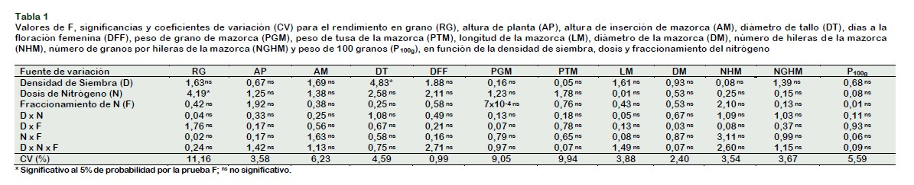
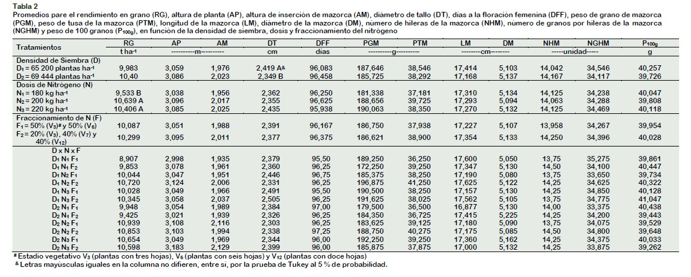

## El artículo

| Dato | Detalle |
|---|---|
| Autores | Julián Chura, Juan Waldir Mendoza-Cortez, José Carlos de la Cruz |
| Revista | *Scientia Agropecuaria*, 10(2): 241–248 (2019) |
| DOI | [10.17268/sci.agropecu.2019.02.09](https://doi.org/10.17268/sci.agropecu.2019.02.09) |
| Cultivo | Maíz amarillo duro (*Zea mays* L.), híbrido |
| Lugar | Campo experimental de la UNALM, Lima, Perú (siembra en setiembre de 2011) |
| Análisis original | ANOVA y prueba de Tukey (5 %) en SAS |

## Resumen

Los autores evaluaron si la dosis de nitrógeno, su fraccionamiento y la densidad de siembra
afectan el crecimiento y el rendimiento del maíz amarillo duro. Midieron doce variables y
reportaron solo dos efectos significativos: la **dosis de nitrógeno** sobre el rendimiento en grano
(200 y 220 kg N/ha superiores a 180 kg N/ha) y la **densidad** sobre el diámetro de tallo.
No encontraron interacciones.

## Diseño experimental

| Elemento | Descripción |
|---|---|
| Diseño | Bloques completos al azar (DBCA), factorial 2 × 3 × 2 |
| Factor D: densidad | 62 500 y 69 444 plantas/ha |
| Factor N: nitrógeno (urea) | 180, 200 y 220 kg N/ha |
| Factor F: fraccionamiento | 2 aplicaciones (50 % V3 + 50 % V7) o 3 aplicaciones (20 % V3 + 40 % V7 + 40 % V12) |
| Bloques | 4 |
| Tratamientos | 12 |
| Unidades experimentales | 48 parcelas de 6 surcos × 7,2 m (0,80 m entre surcos) |
| Variables | Rendimiento en grano, altura de planta y de mazorca, diámetro de tallo, días a floración femenina, peso de grano y de tusa por mazorca, longitud y diámetro de mazorca, hileras por mazorca, granos por hilera y peso de 100 granos |

Modelo del artículo:

$$
Y_{ijkl} = \mu + \beta_l + D_i + N_j + F_k + (DN)_{ij} + (DF)_{ik} + (NF)_{jk} + (DNF)_{ijk} + \varepsilon_{ijkl}
$$

## Los datos que publica el artículo

El artículo **no publica los datos por parcela**. Solo presenta los valores F con su coeficiente
de variación (Tabla 1) y las medias de los 12 tratamientos (Tabla 2).





## Nuestra base de datos ordenada

Pasamos la Tabla 2 a formato *tidy*: una fila por tratamiento, una columna por variable y los
factores con su valor real en vez de códigos (D1, N2, F1…).

```{r}
library(knitr)
medias <- read.csv("data/maiz_medias.csv")
kable(medias[, 1:8], caption = "Primeras columnas de data/maiz_medias.csv (12 tratamientos).")
```

Comprobamos la transcripción: las medias por factor que calculamos con esta base coinciden con
las que publica el artículo hasta el tercer decimal.

```{r}
aggregate(rendimiento_t_ha ~ nitrogeno_kg_ha, data = medias, FUN = function(x) round(mean(x), 3))
```
