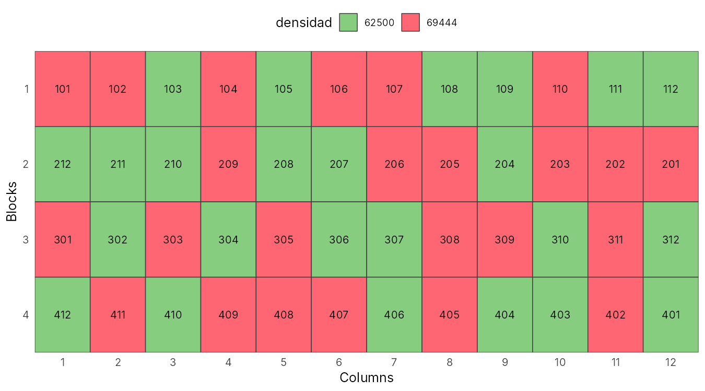

## Errores e inconsistencias del artículo

| Dónde | Problema | Consecuencia |
|---|---|---|
| Tabla 1 | Los valores F de **hileras por mazorca** no corresponden a las medias de la Tabla 2 | La interacción N × F sería significativa (p = 0,039) y se reporta como no significativa |
| Tabla 2 | Letras de Tukey: 220 kg N/ha lleva "A" cuando no difiere de 180 kg N/ha | Se exagera la ventaja de las dosis altas |
| Análisis | El nitrógeno, un factor cuantitativo, se compara con Tukey | No se estima la forma de la respuesta ni una dosis óptima |
| Resultados | Se destaca una "mejor combinación" sin interacción significativa | Recomendación sin respaldo estadístico |
| Análisis | 84 pruebas F sin corrección por comparaciones múltiples | Los dos efectos significativos son compatibles con el azar |
| Tabla 2 | La densidad D1 figura como 65 200 plantas/ha; en la metodología es 62 500 | Con 0,80 m × 0,40 m y dos plantas por golpe salen 62 500; 65 200 es un error de digitación |
| Tabla 2 y conclusiones | La segunda aplicación figura como V7 (metodología), V6 (Tabla 2) y V2 (conclusiones) | No se sabe con certeza cuándo se aplicó el nitrógeno |
| Datos | No se publican los datos por parcela | No se pueden revisar supuestos (normalidad, homogeneidad) ni repetir el análisis completo |

## Qué cambia en las conclusiones

- La conclusión de que **más nitrógeno que 180 kg N/ha mejora el rendimiento** se sostiene solo como
  tendencia lineal débil (p = 0,037), y no sobrevive a la corrección por pruebas múltiples.
- **No se puede afirmar** que 200 kg N/ha sea la dosis óptima: 200 y 220 no difieren, y la curvatura no es significativa.
- La ausencia de efecto de la densidad y del fraccionamiento es, en realidad, **falta de potencia**:
  el ensayo no detecta diferencias de rendimiento menores al 9 %.

## Propuesta: repetir el experimento con un libro de campo reproducible

Diseñamos la réplica del experimento con **Tarpuy** (paquete `inti` de R), con los mismos factores
y bloques que el artículo, para registrar esta vez **los datos de cada parcela**.

```{r}
#| eval: false
#| code-fold: false
library(inti)

factores <- list(
  densidad        = c("62500", "69444"),
  nitrogeno       = c("180", "200", "220"),
  fraccionamiento = c("2ap", "3ap")
)

fb <- design_repblock(nfactors = 3, factors = factores, type = "rcbd",
                      rep = 4, zigzag = TRUE, seed = 2019)

tarpuy_plotdesign(fb)
```



```{r}
libro <- read.csv("data/libro_campo_maiz.csv")
knitr::kable(head(libro[, c("plots", "block", "densidad", "nitrogeno", "fraccionamiento")], 12),
             caption = "Primer bloque del libro de campo (48 parcelas en total).")
```

Mejoras que proponemos para la réplica:

1. **Publicar los datos por parcela** junto al artículo (CSV en un repositorio).
2. Agregar un **testigo sin nitrógeno** y ampliar el rango de dosis (por ejemplo 0, 100, 200 y 300 kg N/ha)
   para poder ajustar una curva de respuesta y estimar la dosis óptima económica.
3. Analizar el nitrógeno con **regresión o contrastes polinomiales**, no con Tukey.
4. Medir el **nitrógeno del suelo antes de la siembra**, ya que los autores atribuyen la falta de respuesta al N residual.

## Referencias

Chura, J., Mendoza-Cortez, J. W., & de la Cruz, J. C. (2019). Dosis y fraccionamiento de nitrógeno en
dos densidades de siembra del maíz amarillo duro. *Scientia Agropecuaria, 10*(2), 241–248.
<https://doi.org/10.17268/sci.agropecu.2019.02.09>

Lozano-Isla, F. (2024). *inti: Tools and Statistical Procedures in Plant Science* [Paquete de R].
<https://CRAN.R-project.org/package=inti>
